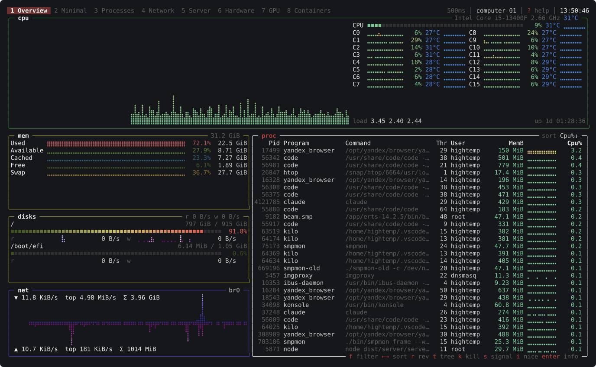

# smpmon

[](https://github.com/hightemp/smpmon/actions/workflows/ci.yml)
[](LICENSE)

A terminal resource monitor in Go, inspired by [btop++](https://github.com/aristocratos/btop), built around **configurable dashboards** and **graphs**.

> **Status:** early development. Linux is the primary platform; macOS and Windows support is new and tested only in CI.



## Features

- CPU (total and per core, frequency, temperature, load), memory and swap (including the ZFS ARC), filesystems, disk I/O, network and processes
- GPUs (NVIDIA through `nvidia-smi`, AMD and Intel through sysfs on Linux), temperature and fan sensors, batteries, and Docker containers
- Linux, macOS and Windows
- Dashboards described as a YAML layout tree of widgets, switchable with `1`–`9`, with size-dependent variants for narrow terminals
- A layout editor inside the TUI (`e`): split, add, delete, move and resize widgets, drag borders with the mouse, edit widget options, undo, and save back to the config file
- Built-in dashboards: `btop`, `minimal`, `procs`, `net`, `server`, `hardware`, `containers`. Widgets whose data isn't available on the machine, such as a battery on a desktop, are hidden automatically
- Graphs in braille, block or ASCII mode, with gradients, mirrored upload/download, and auto or log scale
- Generic `graph`, `gauge`, `stat` and `table` widgets that show any metric by selector, such as `cpu.core.*.usage` or `net.*.*_bps`
- A process table with configurable columns, sorting, filtering, a tree view, a details panel, signals and renice
- Mouse support, built-in themes, and config hot reload
- A single static binary with no cgo

- Remote monitoring: watch your servers over SSH with nothing to set up but the binary, switch between hosts, see all of them on one overview, or mix hosts on one dashboard

- History on disk (optional): scroll back through hours or days of data, including the top processes at the time

- Alerts: threshold rules with notifications in the TUI, on the desktop, through a command or a webhook

Planned: Prometheus export and a headless mode.

## Install

Homebrew (macOS, Linux):

```sh
brew install --cask hightemp/tap/smpmon
```

Scoop (Windows):

```powershell
scoop bucket add hightemp https://github.com/hightemp/scoop-bucket
scoop install smpmon
```

From source (requires Go 1.26+):

```sh
go install github.com/hightemp/smpmon/cmd/smpmon@latest
```

Prebuilt binaries and deb/rpm packages are published on the [Releases](https://github.com/hightemp/smpmon/releases) page.

### Platform notes

| | Linux | macOS | Windows |
|---|---|---|---|
| CPU, memory, disks, network, processes | `/proc`, `/sys` | sysctl, libproc | Win32, NT API |
| Temperatures | hwmon | SMC | WMI (often needs administrator rights) |
| GPU | NVIDIA, AMD, Intel | — | NVIDIA |
| Battery | sysfs | `pmset` | `GetSystemPowerStatus` |
| Docker | socket | Docker Desktop, Colima | `DOCKER_HOST=tcp://…` only |
| Process signals | all | all | terminate only |

## Usage

```sh
smpmon                    # start the TUI
smpmon -d procs           # open a specific dashboard
smpmon -c config.yaml     # use a specific config file
smpmon connect user@server            # monitor a server over SSH
smpmon connect --install web1 db      # install smpmon there first
smpmon snapshot           # print all current metrics once
smpmon snapshot -s 'net.total.*' --json
smpmon config default     # print the default config with comments
smpmon config validate    # check your config
smpmon version
```

### Keys

These are the default bindings; `?` shows the current ones. A `vim` preset and per-action overrides are available, see [Key bindings](#key-bindings).

| Key | Action |
|---|---|
| `1`–`9` | switch dashboard |
| `tab` / `shift+tab` | focus next / previous widget |
| `z`, `esc` | zoom the focused widget, unzoom |
| `+` / `-` | change the update interval |
| `g` | cycle graph mode (braille / block / ascii) |
| `T` | choose a theme |
| `e` | edit the dashboard layout |
| `H` | choose the host to show |
| `[` / `]` | go back / forward in recorded history |
| `w` | change the history window (10m, 1h, 6h, 24h, 7d) |
| `p` | pause the display |
| `?` | help |
| `q`, `ctrl+c` | quit |

In the process widget:

| Key | Action |
|---|---|
| `↑` `↓` `pgup` `pgdn` `home` `end` | select a process |
| `←` `→`, `r` | change the sort column, reverse the order |
| `f` or `/` | filter by name, command, user or pid |
| `t`, `space` | tree view, collapse or expand a branch |
| `enter` | details panel |
| `k` / `K` / `s` | send SIGTERM / SIGKILL / pick a signal |
| `i` | renice |
| `c` | show CPU per core or as a share of the whole machine |

In the network widget, `b` and `n` switch the interface. In the Docker widget, `←` `→` change the sort order and `a` shows stopped containers. Mouse: click a widget or tab to select it, click a column header to sort, use the wheel to scroll.

## Remote monitoring

smpmon shows other machines the same way as this one. The simplest way is SSH:

```sh
smpmon connect --install deploy@web1   # first time: puts smpmon in ~/.local/bin on the server
smpmon connect deploy@web1 db          # later; names from ~/.ssh/config work too
```

`connect` runs `smpmon agent --stdio` on the server through your `ssh` command, so your keys, `ssh-agent`, `~/.ssh/config`, jump hosts and known hosts all apply. Nothing listens on the network, and only the data shown on screen is collected. Login must work without a password prompt: use keys, and connect once with plain `ssh` to accept the host key. `--install` copies this binary if the server runs the same OS and architecture, and otherwise downloads the matching release and checks its checksum. Set `SMPMON_SSH` to use a different ssh program.

Hosts you watch regularly go into the config. They connect when smpmon starts, and a Hosts tab appears:

```yaml
hosts:
  web1: {ssh: deploy@web1}
  db:   {ssh: db}               # an alias from ~/.ssh/config
```

- `H` switches every dashboard to another host. The top bar shows the host and its state.
- The Hosts dashboard has a card per host with CPU, memory, the fullest disk, network, load and latency. `enter` shows that host.
- `source: <host>` on a widget shows that host on any dashboard, e.g. the CPUs of three servers side by side.
- When a host drops, its widgets keep the last data and the top bar says how long it has been offline. smpmon reconnects automatically.
- Processes on a remote host can be killed and reniced with the rights of the SSH user. Confirmations name the host.

### Network agent

For machines without SSH access, or for many clients, run a network agent with TLS and a token:

```sh
smpmon agent gen-cert --out /etc/smpmon --host server.example.com   # prints the certificate fingerprint
smpmon agent gen-token > /etc/smpmon/agent.token
smpmon agent --listen :9200 --cert /etc/smpmon/agent.crt --key /etc/smpmon/agent.key \
  --token-file /etc/smpmon/agent.token
```

```yaml
hosts:
  edge: {url: "tls://server.example.com:9200", token_file: ~/.config/smpmon/edge.token, fingerprint: "sha256:…"}
```

The fingerprint pins the self-signed certificate. Without it, the certificate must be trusted by the system. With `--token-file`, clients can only read metrics; `--control-token-file` sets a second token that also allows kill and renice. The deb and rpm packages install a disabled `smpmon-agent` systemd unit configured in `/etc/smpmon/agent.env`. A launchd job for macOS is in `packaging/`.

## History

With history enabled, smpmon records metrics to disk and lets you look back:

```yaml
history:
  enabled: true
  retention: {raw: 1h, 10s: 24h, 1m: 168h}   # per resolution
  max_size_mb: 200                          # per host
```

- `[` goes back in time and `]` forward; past the present you're back to live data, and `esc` returns directly. `w` changes the window length.
- All dashboards show the recorded window. Graphs fit the whole window, and numbers show the values at its end.
- The process table shows the top 20 processes by CPU and by memory at that moment, recorded every 10 seconds.

Data is kept at three resolutions (every second, 10-second and 1-minute averages), and the coarsest one that still covers the window is used. Remote hosts are recorded too, each in its own directory under `~/.cache/smpmon/history/`. A broad default set of metrics is recorded; `history.metrics` takes selectors to change it. The collectors needed for recording keep running even when no widget shows their data. The files are compact: the column-wise compressed format stores slowly changing metrics in about a byte per value.

## Alerts

```yaml
alerts:
  - name: disk-full
    expr: "disk.fs.*.used_percent > 90"   # selector, >, >=, <, <=, == or !=, a number
    for: 1m                               # must hold this long
    level: crit                           # warn (default) or crit
    notify: [tui, desktop, webhook]
    webhook: https://hooks.example.com/smpmon
  - name: memory
    expr: "mem.available < 1GiB"          # k, M, G, Ki, Mi, Gi suffixes
    hysteresis: 256Mi                     # how far past the threshold to resolve
    notify: [tui, exec]
    exec: 'logger "$SMPMON_ALERT_MESSAGE"'
    hosts: [web1, db]                     # default: every host
```

Every series a selector matches is a separate alert, per host. A disk rule fires for the disk that fills up, and it resolves when that disk drops below the threshold or disappears.

- **TUI.** A message appears, a `⚠ N` badge stays in the top bar, and widgets showing the affected data get a red or yellow border. The `alerts` widget lists firing alerts and recent events.
- **Desktop.** Notifications go through `notify-send` on Linux and the notification center on macOS. On Windows a toast is shown; this hasn't been tested yet.
- **Exec.** The command runs in `sh -c` (`cmd /C` on Windows) with `SMPMON_ALERT`, `SMPMON_ALERT_STATE` (firing or resolved), `SMPMON_ALERT_LEVEL`, `SMPMON_ALERT_HOST`, `SMPMON_ALERT_METRIC`, `SMPMON_ALERT_VALUE`, `SMPMON_ALERT_THRESHOLD` and `SMPMON_ALERT_MESSAGE` in its environment.
- **Webhook.** A JSON object with the same fields is POSTed to the URL.

After an alert resolves, it doesn't fire again for `cooldown` (default 1m). Stale data, for example from an offline host, neither fires nor resolves alerts.

## Configuration

The config lives in `~/.config/smpmon/config.yaml` (`smpmon config path` prints the exact location). It only needs to contain what you change: it is merged over the built-in defaults, which `smpmon config default` prints with comments. Edits are applied while smpmon is running.

```yaml
general:
  interval: 1s           # minimum 100ms
  graph_mode: braille    # braille | block | ascii
  theme: default         # default | nord | gruvbox | dracula | monochrome
  border: rounded        # rounded | single | double | thick | none
  dashboards: [btop, mine, procs]
  default_dashboard: mine

collectors:
  procs: {interval: 2s}

dashboards:
  mine:
    title: My dashboard
    layout:
      col:
        - row:
            - widget: cpu
              weight: 2
            - widget: gauge
              title: Root FS
              options: {metric: "disk.fs./.used_percent", gradient: disk}
          size: 40%
        - row:
            - widget: graph
              title: Cores
              options:
                metrics: ["cpu.core.*.usage"]
                window: 5m
                mode: block
            - widget: proc
              weight: 2
              options:
                columns: [pid, user, cpu, mem, rss, name, cmd]
                sort: {by: mem}
    variants:
      - when: {max_width: 99}   # narrow terminals
        layout:
          col:
            - widget: cpu
            - widget: proc
```

A layout node is one of `row` (children side by side), `col` (children stacked) or `widget`. A node's share of its parent is set with `size: 10` (cells), `size: 30%` or `weight: 2` (share of the remaining space, default 1), optionally bounded by `min` and `max`.

### Layout editor

Press `e` to edit the current dashboard. The selected widget or container is highlighted and its path is shown in the top bar.

| Key | Action |
|---|---|
| `←` `↑` `→` `↓`, mouse click | select the neighbouring widget |
| `[` / `]` | select the parent container / first child |
| `s` / `v` | add a widget to the right / below |
| `a` | add a widget after the selection |
| `d` | delete |
| `<` / `>` | move before / after the neighbour |
| `+` / `-`, drag a border | resize |
| `r` | switch a container between row and column |
| `t` | change the widget type |
| `o`, `enter` | edit title, size and widget options |
| `u` / `U` | undo / redo |
| `n` / `R` | new dashboard / rename |
| `ctrl+s` | save |
| `esc` | leave the editor |

Saving writes only `dashboards.<name>` (and the tab list) into your config file. Everything else, including comments, is kept, and the previous file is saved as `config.yaml.bak`. When the terminal is narrow enough for a dashboard's `variants` to apply, the editor changes that variant.

### Key bindings

```yaml
keys:
  preset: vim            # default | vim
  bind:                  # action: [keys]; an empty list unbinds
    quit: [q, ctrl+q]
    proc_kill: [x]
    pause: []
```

The `vim` preset adds `h` `j` `k` `l`, `ctrl+u` / `ctrl+d`, `g` / `G` for navigation, moves kill to `x` / `X` and graph mode to `M`. Keys are names like `x`, `X`, `ctrl+u`, `shift+tab`, `pgdown`, `space`, `enter`, `f5`. Keys bound to two actions that are active at the same time are reported as errors. A key bound in a widget shadows the same global key while that widget is focused. `ctrl+c` always quits.

Actions: `quit`, `help`, `focus_next`, `focus_prev`, `zoom`, `back`, `pause`, `interval_up`, `interval_down`, `graph_mode`, `theme`, `edit`, `host`, `history_back`, `history_forward`, `history_window`, `dashboard_1`…`dashboard_9`; navigation `up`, `down`, `page_up`, `page_down`, `home`, `end`, `left`, `right`; processes `proc_filter`, `proc_reverse`, `proc_tree`, `proc_collapse`, `proc_details`, `proc_kill`, `proc_kill_force`, `proc_signal`, `proc_renice`, `proc_per_core`; `net_prev`, `net_next`; `docker_all`; editor `edit_parent`, `edit_child`, `edit_split_h`, `edit_split_v`, `edit_add`, `edit_delete`, `edit_move_prev`, `edit_move_next`, `edit_grow`, `edit_shrink`, `edit_rotate`, `edit_type`, `edit_options`, `edit_undo`, `edit_redo`, `edit_save`, `edit_new`, `edit_title`.

### Themes

Built-in themes: `default` (btop colors), `nord`, `gruvbox`, `dracula`, `monochrome`. To make your own, export one and edit it:

```sh
mkdir -p "$(smpmon theme path)"
smpmon theme export nord > "$(smpmon theme path)/mine.yaml"
```

A theme only needs the colors it changes; the rest come from the theme named in `inherit` (default: `default`). Set `general.theme: mine` or press `T` to switch. `general.color` forces the color depth (`truecolor`, `256`, `16` or `none`) when detection gets it wrong.

### Widgets

| Widget | Options |
|---|---|
| `cpu` | `cores` (bool), `mode` |
| `mem` | `graph` (bool), `mode` |
| `disks` | `mounts` (list), `io` (bool) |
| `net` | `interface` (`auto` or a name), `scale` (`auto` or `log`), `mode` |
| `proc` | `columns`, `sort: {by, desc}`, `tree`, `filter`, `per_core` |
| `graph` | `metrics` (selectors), `window`, `mode`, `style` (`area` or `line`), `scale`, `min`, `max`, `gradient`, `legend`, `limit` |
| `gauge` | `metric`, `max`, `gradient` |
| `stat` | `metric`, `sparkline`, `gradient` |
| `table` | `metrics` (selectors) |
| `text` | `text` (with `{hostname}` `{os}` `{kernel}` `{uptime}` `{time}` `{date}`), `align` |
| `hosts` | — (overview of all hosts) |
| `alerts` | — (firing alerts and recent events) |
| `gpu` | `index`, `mode` |
| `sensors` | `filter`, `fans` (bool) |
| `battery` | — |
| `docker` | `all` (include stopped), `sort` (`cpu`, `mem`, `net` or `name`) |

Process columns: `pid`, `ppid`, `name`, `cmd`, `user`, `state`, `threads`, `nice`, `cpu`, `mem`, `rss`, `vms`, `read`, `write`, `time`, `start`.

### Metrics

Metric keys are dot-separated. Selectors support `*` (one segment), `**` (any number of segments) and globs inside a segment (`*_bps`, `eth?`). Run `smpmon snapshot` to list every metric on your machine.

| Keys | Unit |
|---|---|
| `cpu.total.{usage,user,system,iowait,steal}`, `cpu.core.<n>.usage` | % |
| `cpu.freq`, `cpu.core.<n>.freq` | Hz |
| `load.{1,5,15}`, `system.uptime` | — , s |
| `mem.{total,used,available,free,cached,buffers,zfs_arc}`, `swap.{total,used,free}` | bytes |
| `mem.used_percent`, `swap.used_percent` | % |
| `disk.fs.<mount>.{total,used,free,used_percent}` | bytes, % |
| `disk.io.<dev>.{read_bps,write_bps,read_iops,write_iops,util}` | bytes/s, 1/s, % |
| `net.<if>.{rx_bps,tx_bps,rx_pps,tx_pps,rx_errs,tx_errs,rx_total,tx_total}` | bytes/s, 1/s, bytes |
| `net.total.*` | sums over physical NICs |
| `proc.{count,threads,running}`, `proc.<pid>.{cpu,mem}` | count, % |
| `cpu.temp`, `sensors.<chip>.<label>.temp`, `sensors.<chip>.<label>.fan` | °C, RPM |
| `gpu.<n>.{util,mem_util,mem_used_percent,fan}`, `gpu.<n>.{mem_used,mem_total}`, `gpu.<n>.temp`, `gpu.<n>.{power,power_limit}`, `gpu.<n>.{clock,mem_clock}` | %, bytes, °C, W, Hz |
| `battery.{percent,power,time_left}` | %, W, s |
| `docker.<name>.{cpu,mem_percent}`, `docker.<name>.{mem_used,mem_limit}`, `docker.<name>.{net_rx_bps,net_tx_bps,blk_read_bps,blk_write_bps}` | %, bytes, bytes/s |

Dots inside a segment are escaped with a backslash, for example `disk.fs./mnt/data\.v2.used`.

## Development

```sh
make build      # build bin/smpmon
make test       # run tests
make lint       # run golangci-lint
make build-all  # cross-compile for all platforms
make help       # list all targets
```

### Releasing

The release version lives in the `VERSION` file.

1. Bump `VERSION`, for example `1.1.0`.
2. Write `release-notes/v<VERSION>.md`. It becomes the description of the GitHub release.
3. Run `make release`. It checks that you're on `main` with no other uncommitted changes and that the notes exist, commits `VERSION` and the notes, creates the `v<VERSION>` tag and pushes the branch and the tag.
4. The `Release` GitHub workflow runs GoReleaser and publishes binaries, checksums and deb/rpm packages. If the `TAP_GITHUB_TOKEN` secret is set (a token with write access to `hightemp/homebrew-tap` and `hightemp/scoop-bucket`), it also updates the Homebrew cask and the Scoop manifest.

## License

[MIT](LICENSE)
